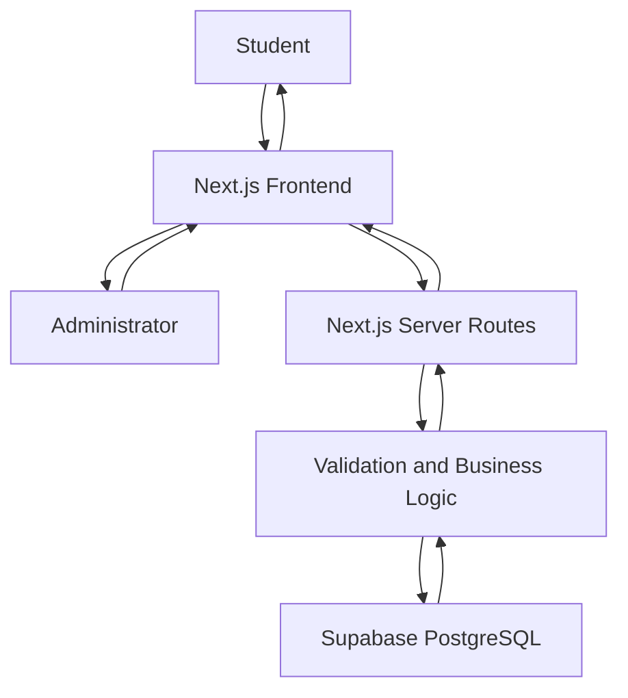

# FixIt — Campus Issues, Solved.

A digital campus issue reporting and tracking platform that helps students report everyday campus problems, discover related reports, support shared issues, and follow their progress.

**Live Demo:** https://aconic-two.vercel.app  
**GitHub Repository:** https://github.com/xaxsxixh/aconic

---

## 1. Overview

FixIt is a campus service request platform designed to make reporting infrastructure and maintenance problems easier for students and campus administrators.

Students often encounter problems such as poor Wi-Fi connectivity, electrical faults, water leakage, unclean spaces, and malfunctioning classroom or laboratory equipment. However, reporting these issues through informal channels can make it difficult to track complaints, identify recurring problems, and understand whether an issue has been addressed.

FixIt provides a centralized platform where students can submit issues without creating an account, discover similar unresolved reports, support existing reports using the **Me Too** feature, and track their activity.

Administrators can access a dedicated dashboard to monitor reports and update their status.

**Core idea: One task, zero friction.**

## 2. Problem Statement

Campus maintenance problems are frequently reported through informal communication channels. This can result in:

- Repeated reports of the same issue.
- Difficulty identifying frequently affected locations.
- Limited visibility into the progress of complaints.
- Lack of a centralized reporting and tracking process.
- Difficulty understanding how many students are affected by an issue.

FixIt addresses these challenges through a simple, centralized reporting and issue-tracking experience.

## 3. Target Users

### Students
- Report campus problems without creating an account.
- Select an issue category and provide its location.
- Discover similar unresolved reports.
- Support an existing report using Me Too.
- Track submitted and supported reports.

### Campus Administrators
- Access a dedicated administration dashboard.
- View and filter reported issues.
- Monitor the number of reports and affected students.
- Update issue statuses.
- Reopen previously fixed issues when necessary.

## 4. Key Features

### Anonymous Issue Reporting
Students can report problems without registering or signing in. Their activity is associated with a browser-based anonymous identity.

### Issue Categories
Reports can be classified into:
- Wi-Fi and Internet
- Electrical Problems
- Water and Plumbing
- Cleaning and Maintenance
- Classroom and Lab Equipment
- Other

### Similar Issue Detection
Before submitting a report, FixIt checks for related unresolved reports using the issue category and normalized location.

Similar reports are suggestions only. Students can still submit a separate report when the problem is different.

### Me Too — Shared Student Support
Students can support existing Received or In Progress reports.

This helps administrators understand when multiple students are affected by the same problem.

Duplicate support from the same anonymous user is prevented.

### My Activity
Students can view their own submitted reports and reports they have supported.

### Administrator Dashboard
Administrators can monitor campus issues through a dedicated dashboard with report counts, filters, search, and status management.

### Issue Status Tracking
Reports follow a clear workflow:

`Received → In Progress → Fixed`

Previously fixed issues can also be reopened when necessary.

### Support Contact
Students can contact the support team directly through the configured email link.

## 5. User Experience Decisions

The project follows the principle of reducing friction while keeping the reporting process understandable.

**1. No mandatory student registration**

Students can report an issue without creating an account. This reduces the effort required to submit a complaint.

**2. Similar reports are suggestions, not restrictions**

Students can discover existing reports and support them rather than creating unnecessary duplicates. However, they are never blocked from reporting a genuinely different issue.

**3. Shared support and transparent progress**

The Me Too feature communicates how many students are affected, while status tracking helps students understand whether an issue is being addressed.

**4. Clear separation of student and administrator experiences**

Students receive a simple reporting and tracking interface, while administrators have a separate dashboard for managing reports.

## 6. Technology Stack

| Layer | Technology |
|---|---|
| Frontend | Next.js |
| Programming Language | TypeScript |
| Styling | Tailwind CSS |
| Backend | Next.js server-side API routes |
| Database | Supabase PostgreSQL |
| Validation | Zod |
| Testing | Vitest |
| Deployment | Vercel |
| Version Control | Git and GitHub |

## 7. System Architecture

FixIt uses a Next.js application with server-side API routes connected to a Supabase PostgreSQL database.



### Architecture Explanation

1. Students and administrators interact with the Next.js frontend.
2. Requests are handled by server-side routes.
3. Input validation and application logic are processed on the server.
4. Supabase stores and retrieves issue and support information.
5. The frontend displays the resulting information to the appropriate user.

The Supabase service-role credential is intended for server-side use only and must never be exposed to the browser.

## 8. Project Structure

The project is organized around the Next.js App Router architecture.

Important directories include:

```text
fixit/
├── app/
│   ├── api/
│   ├── activity/
│   ├── admin/
│   ├── page.tsx
│   └── globals.css
├── components/
│   ├── ui/
│   └── ...
├── lib/
│   ├── auth/
│   ├── dates/
│   ├── issues/
│   ├── support/
│   └── ...
├── supabase/
│   └── migrations/
├── tests/
├── public/
├── .env.example
├── package.json
└── README.md
```

## 9. Getting Started

### Prerequisites

Install the following:

- Node.js (LTS recommended)
- npm
- Git
- A Supabase project

### Clone the Repository

```bash
git clone https://github.com/xaxsxixh/aconic.git
cd aconic
```

### Install Dependencies

```bash
npm install
```

### Configure Environment Variables

Create a `.env.local` file in the project root.

Add the following variables using your own configuration:

```env
SUPABASE_URL=your_supabase_project_url
SUPABASE_SERVICE_ROLE_KEY=your_supabase_service_role_key
COOKIE_SIGNING_SECRET=your_strong_random_secret
ADMIN_ACCESS_CODE=your_admin_access_code
```

If the application uses the configurable support email:

```env
FIXIT_SUPPORT_EMAIL=support@gmail.com
```

**Security notes:**
- Never commit `.env.local`.
- Never expose the Supabase service-role key through a `NEXT_PUBLIC_` variable.
- Use a strong, unique cookie-signing secret.
- Do not share administrator access credentials.

### Database Setup

Create a Supabase project and apply the database migration located at:

```text
supabase/migrations/202611170001_initial_schema.sql
```

Use the migration appropriate to the repository's current database state. Do not reapply an already-applied initial migration.

### Run the Development Server

```bash
npm run dev
```

Open:

http://localhost:3000

## 10. Application Routes

| Route | Purpose |
|---|---|
| `/` | Landing page and issue reporting |
| `/activity` | Student activity and report tracking |
| `/admin/login` | Administrator authentication |
| `/admin` | Administrator dashboard |

The application also uses server-side API routes for reporting, support, authentication, and issue management.

## 11. Testing and Code Quality

FixIt uses Vitest for automated testing.

Run the test suite:

```bash
npm test
```

Run lint checks:

```bash
npm run lint
```

Create a production build:

```bash
npm run build
```

These checks help validate application logic, identify code-quality issues, and catch build errors.

## 12. Security and Privacy Considerations

- Student activity is associated with a server-generated anonymous browser identity.
- Authentication cookies are configured as HTTP-only and use appropriate SameSite and production Secure settings.
- Administrator sessions use signed, expiring cookies.
- Database credentials are kept on the server.
- User input is validated before processing.
- Clearing browser cookies can cause a student to lose access to their previously associated anonymous activity.

The current administrator session implementation clears the browser cookie on logout. It does not provide individual server-side revocation of an already copied session token before its expiry.

## 13. Limitations and Future Improvements

Potential improvements include:

- Institutional single sign-on integration.
- Email or in-app notifications for status updates.
- Image attachments for issue evidence.
- More advanced duplicate detection.
- Analytics for recurring campus infrastructure problems.
- Role-based administrator permissions.
- Stronger centralized session revocation.

These are future enhancements and are not represented as currently implemented features.

## 14. Deployment

The application is deployed using Vercel.

**Live Application:** https://aconic-two.vercel.app

The deployment uses environment variables to connect the Next.js server-side application to Supabase.

For production deployment, configure the required environment variables in the Vercel project settings and redeploy after configuration changes.

## 15. AI Usage Disclosure

AI-assisted development tools were used during the development process to support:

- Understanding and planning application architecture.
- Generating and refining implementation ideas.
- Debugging and resolving development issues.
- Reviewing UI/UX improvements.
- Preparing documentation.

The developer reviewed the implementation, made project decisions, and used testing and browser verification to evaluate the application.

AI assistance was used as a development aid rather than as a replacement for engineering review.

## 16. Project Information

**Project Name:** FixIt — Campus Issues, Solved.

**Organization:** Aconic Technologies — Assessment Project

**Repository:** https://github.com/xaxsxixh/aconic

**Deployment:** https://aconic-two.vercel.app

---

*FixIt — A clearer way to care for campus.*
